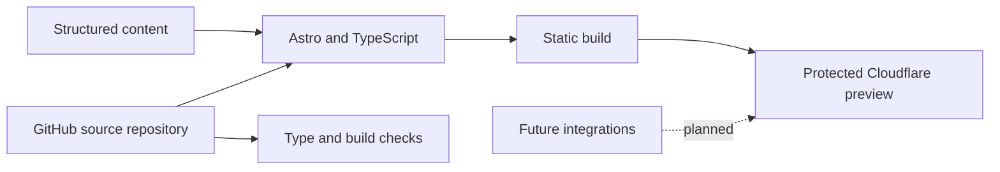

# Consulting website: from positioning to a maintainable platform

**Status:** implemented private prototype. Not publicly launched.

## Business problem

Create a credible digital presence for a consulting business without becoming dependent on a proprietary website builder. The site needs to explain services, demonstrate experience, publish useful content and support search and AI-assisted discovery.

## Approach

- Define service categories, information architecture and evidence-based content.
- Use Astro and TypeScript with static output and reusable content structures.
- Organise pages around distinct topics and meaningful search intent rather than duplicate keyword variants.
- Separate future backend integrations from the static presentation layer.
- Keep the GitHub codebase private and use a protected Cloudflare preview during development.

## Architecture

## What is implemented

Responsive pages, service descriptions, articles, experience and technology sections, a static build configuration, a private preview and build validation configuration. A contact form exists only as a local test, not a live lead-capture service.

## My contribution

Business positioning, service and content requirements, architecture decisions, iterative review and AI-assisted implementation. The site was built with coding assistants; I do not claim to have manually authored every line of code.

## Next validation steps

Confirm public access, approve launch content, verify all forms and data flows, run production build and security checks, and establish a baseline for search performance. No SEO rankings, AI citations or conversion results are claimed at prototype stage.

The underlying implementation remains private; this case is a public-safe description.
