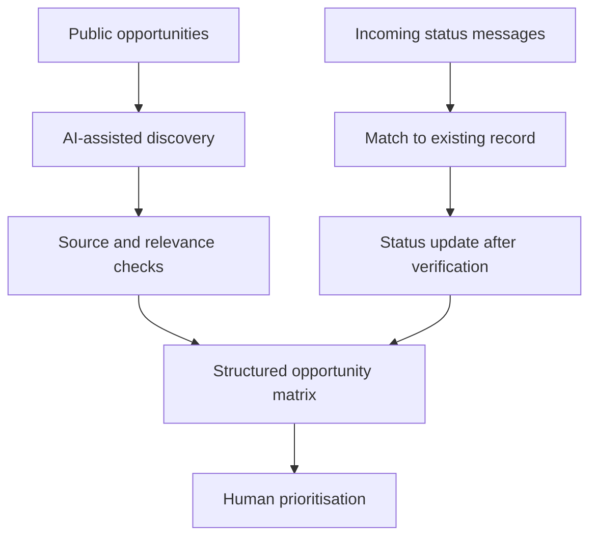

# AI job intelligence: research and workflow automation

**Status:** personal workflow in use. This is a design summary, not a source-code release.

## Problem

Manual discovery and tracking of opportunities creates repetitive work, inconsistent qualification and fragmented status information. The same challenge appears in commercial prospect research and sales pipeline management.

## Workflow

The personal workflow uses AI-assisted research, Google Sheets for structured tracking and Gmail for relevant status messages. Scheduled tasks support discovery and status maintenance. Human review is important for relevance, ambiguous matches and next actions.

## Design principles

- Retain the original source and evidence for each opportunity.
- Separate discovery from decisions to pursue an opportunity.
- Match organisations and positions before updating statuses.
- Avoid treating every incoming message as a confirmed outcome.
- Keep personal records and connected-account content private.

## Transfer to marketing

The pattern can be adapted to account research, buying signals, campaign intelligence or lead qualification. Different sources, matching rules and governance would need to be validated for each commercial use case.

No efficiency percentage or commercial outcome is claimed. This repository does not contain personal data, live credentials or the private tracking system.
