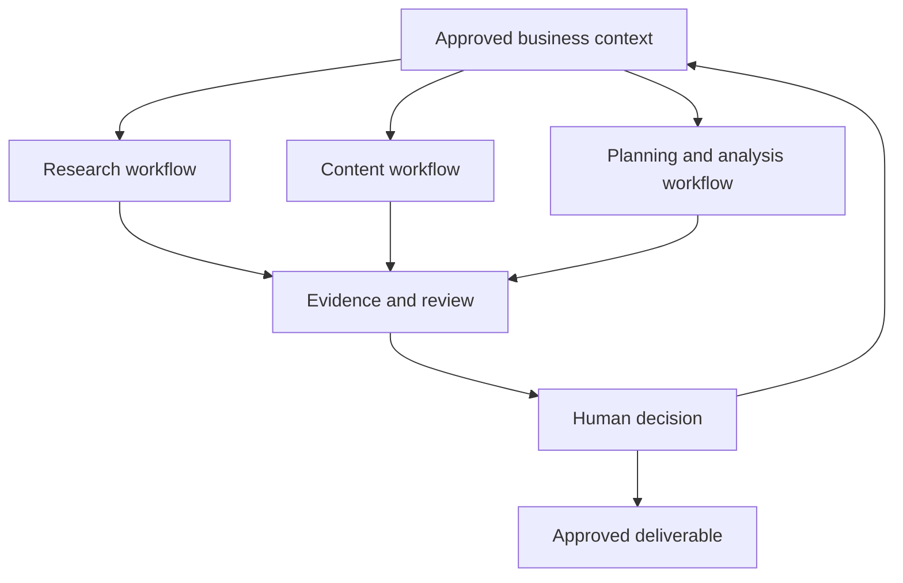

# AI-enabled marketing operating system

**Status:** working methods and project design, not a packaged or fully integrated software product.

## Problem

Marketing teams often lose context across research, positioning, content, campaigns, stakeholders and reporting. Generating more content with AI does not solve the underlying coordination problem.

## Design

A shared knowledge base holds approved business context, evidence, target audiences and decisions. Specialised AI workflows use that context for research, drafting, analysis and review. Humans retain ownership of commercial decisions and external publication.

## What matters in practice

- Define an outcome and a responsible person for each workflow.
- Preserve context and source evidence across workstreams.
- Separate hypotheses from verified facts.
- Use review gates for public claims, sensitive data and external actions.
- Measure quality, time spent, rework and business outcomes before expanding automation.

## My contribution

Business and marketing requirements, instructions for specialised workflows, knowledge organisation and iterative review of AI-assisted outputs.

This case describes an approach I use and develop. It does not represent an independently deployed enterprise platform or a claim of autonomous end-to-end execution.
